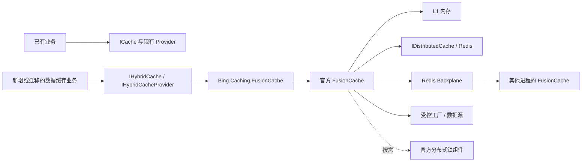

# FusionCache 缓存集成解决方案

- Task ID：`20261024-fusioncache-integration`
- 设计日期：2026-10-24；源码与上游资料在本次会话核对。
- 状态：用户已批准，进入实施。文中的新增接口、注册入口、目录和测试方法均为设计目标。
- 目标：为 Bing.NetCore 增加可选的 FusionCache 集成，提供易用的分层缓存、回源保护、容错及多实例失效能力。
- 本轮交付：本计划；实现阶段依次执行 FC-00～FC-08。

## 1. 推荐方案

新增独立包 **`Bing.Caching.FusionCache`**，依赖 `Bing.Caching` 和官方 FusionCache。业务通过新增的轻量 **`Bing.Caching.IHybridCache`** 使用缓存，通过 **`IHybridCacheProvider`** 选择命名实例。现有 `ICache`、CSRedis、FreeRedis、EasyCaching 继续服务已有业务。

这个选择来自现有契约：`ICache` 同时承诺 TrySet、前缀/模式扫描、批量与流式读取等能力；FusionCache 的公开接口主要面向单键数据缓存、工厂回源和标签失效。硬套完整 `ICache` 会引入无法等价的实现，例如先查询再写入冒充原子 TrySet，或者用标签代替任意前缀扫描。

首版交付完整的新缓存使用路径，不注册一个大量方法抛出 `NotSupportedException` 的 `ICache` 适配器。已有业务迁移时，逐个调用点切换到 `IHybridCache`；需要原子条件写入、扫描管理或既有租约语义的调用继续使用原接口。

推荐部署组合：

| 场景 | 组合 | 定位 |
| --- | --- | --- |
| 开发、单实例工具 | FusionCache + L1 内存 | 无 Redis 也可使用基础缓存与同键回源合并 |
| 多实例业务服务 | L1 + Redis `IDistributedCache` + Redis Backplane | 首版生产推荐组合，传播缓存更新/失效 |
| 回源代价特别高 | 上述组合 + 官方分布式锁组件 | 减少不同节点的重复回源，按需开启 |
| 依赖原子 TrySet、SCAN、已有 outbox | 原有 `ICache` Provider | 与新缓存并存，保持既有业务语义 |

### 1.1 方案比较

| 方案 | 优点 | 代价 | 结论 |
| --- | --- | --- | --- |
| 业务直接使用 `IFusionCache` | 代码最少，所有原生能力立即可用 | 业务依赖厂商类型；键空间和资源策略需各自维护 | 适合应用自行试用；框架集成仍提供统一边界 |
| 新增 `IHybridCache` + 独立适配包 | 不破坏既有接口，行为可完整测试，依赖集中在集成层 | 增加少量接口及转换代码；迁移要改注入点 | **推荐** |
| FusionCache 完整实现 `ICache` | 表面上无需改业务注入 | 原子写入、扫描和协调契约不等价；需要维护额外索引/协议 | 首版不采用 |
| 包装在 EasyCaching Hybrid 外面 | 可以复用旧注册入口 | 双重 L1、锁、TTL、序列化与失效链，故障定位复杂 | 不采用 |

## 2. 当前仓库真实状态

下列路径已核对；行为结论来自源码，已有测试名称仅代表覆盖入口，本轮没有重新运行测试。

| 已确认文件 | 当前行为 | 对本方案的影响 |
| --- | --- | --- |
| `framework/src/Bing.Caching/Bing/Caching/ICache.cs`、`ICache.Async.cs` | 同步/异步单键、原子意图的 TrySet、顺序批量、前缀/模式删除、流式读取、运行时 Type 读取 | 无法仅映射 FusionCache 单键 API 就称为完整兼容 |
| `framework/src/Bing.Caching/Bing/Caching/CacheEntry.cs` | `Key`、`Value`、`Hit` 可区分 null 命中和 miss | 新 TryGet 复用该返回类型 |
| `framework/src/Bing.Caching/Bing/Caching/CacheOptions.cs` | 当前仅有可空 `Expiration` | 首版保留简单的每次调用 TTL 配置 |
| `framework/src/Bing.Caching/Bing/Caching/CacheConfiguration.cs` | 非空 Namespace/ProviderName；默认 TTL 8 小时；毫秒向上取整；TTL 上限为 `int.MaxValue` 毫秒 | 旧行为不改；新集成使用单独配置，避免继承 Redis 专属上限 |
| `framework/src/Bing.Caching/Bing/Caching/CacheKeyFormat.cs` | `bing:v2:` 物理空间、转义、哈希标签和扫描解析 | 复用输入校验思路；FusionCache 使用独立格式，不读取旧载荷 |
| `framework/src/Bing.Caching/Bing/Caching/CacheFactoryAdmission.cs` | 进程内回源并发及队列预算，按资源配置对象共享状态 | 可复用内部准入器，不重写第二套队列算法 |
| `framework/src/Bing.EasyCaching/Bing/EasyCaching/CacheManager.cs` | 命中先读；未命中同键 gate；再次检查；准入；回源/租约；写回 | 说明现有回源保护已真实实现，不应重新建设旧路径 |
| `framework/src/Bing.EasyCaching/Bing/EasyCaching/CachingServiceCollectionExtensions.cs` | 注册 Memory/Redis/Hybrid；`ICache` 使用 `TryAddScoped` | 新注册入口避免隐式抢占旧默认 Provider |
| `framework/src/Bing.EasyCaching/Bing/EasyCaching/CacheManager.Hybrid.cs`、`CacheManager.Mutations.cs` | Hybrid 回填及写入协调；相关职责还分散在同目录协调类 | 既有协议不与 FusionCache Backplane 混用 |
| `framework/src/Bing.AspNetCore.Authentication.JwtBearer/Bing/Identity/JwtBearer/Internal/JsonWebTokenStore.cs` | Token 存储依赖 `ICache` 的 Set/Remove/Exists/Get | 首轮不迁移；过期值降级会影响此类业务判断 |
| `modules/admin/src/Bing.Admin/Modules/CacheModule.cs` | 当前显式注册 CSRedis 与 scoped `ICache` | 新示例独立展示，不直接改 Admin 默认配置 |
| `framework.props`、`framework.tests.props`、`global.json` | 主库默认 netstandard2.0；现有测试 net8.0/net6.0；SDK 10.0.400 | SDK 版本不等于库和宿主目标框架 |
| `docs/modules/caching.md`、`docs/migrations/cache-namespace-v2.md` | 已记录命名空间、回源、预算、Hybrid 与 outbox 边界 | 实现后新增 FusionCache 专节和独立迁移说明 |

完成度判断：

- **已实现**：现有缓存抽象和多个 Provider；现有回源、命名空间、预算及失效机制有真实实现与测试。
- **部分可复用**：`CacheOptions`、`CacheEntry<T>`、输入校验、回源准入、测试方法学。
- **未实现**：FusionCache 包引用、专用适配器、注册入口、轻量 Hybrid 契约、样例及针对性测试。当前相关源码与工程搜索未发现该集成。
- **待验证**：新依赖图、宿主兼容性、FusionCache 双节点失效与故障恢复、资源和性能数据。
- 不能把旧 Provider 的测试成功视为 FusionCache 已验收；也不以一个主观百分比替代上述状态。

## 3. 上游版本与依赖策略

本次查询 NuGet 展示 FusionCache **2.9.0**；设计以 `v2.9.0` 标签的源码为依据，避免将 `main` 分支新能力误写为已发布能力。[S1](https://www.nuget.org/packages/ZiggyCreatures.FusionCache/2.9.0) [S2](https://github.com/ZiggyCreatures/FusionCache/blob/v2.9.0/src/ZiggyCreatures.FusionCache/ZiggyCreatures.FusionCache.csproj)

| 依赖 | 作用 | 本次核对结果 / 采用方式 |
| --- | --- | --- |
| `ZiggyCreatures.FusionCache` | 核心引擎 | 2.9.0，候选锁定版本 |
| `ZiggyCreatures.FusionCache.Serialization.SystemTextJson` | L2 序列化 | 2.9.0；引用 `System.Text.Json 10.0.1` |
| `Microsoft.Extensions.Caching.StackExchangeRedis` | L2 `IDistributedCache` | 10.0.1，用户已批准固定版本 |
| `ZiggyCreatures.FusionCache.Backplane.StackExchangeRedis` | 多节点失效通知 | 2.9.0；引用 `StackExchange.Redis 2.10.1` |
| `ZiggyCreatures.FusionCache.Locking.Distributed.Redis` | 可选分布式回源合并 | 2.9.0；不是 Redis Backplane 隐含附带的能力 |
| `ZiggyCreatures.FusionCache.OpenTelemetry` | 可选遥测接线 | 按需放在宿主，不强制所有应用依赖遥测 SDK |
| 官方 Memory Backplane / Memory Distributed Locker | 单元测试替身 | 仅测试项目引用，不能证明 Redis 实机行为 |

核心包标签源码包含 netstandard2.0/net8.0/net9.0/net10.0 资产，但同时引用 `Microsoft.Extensions.Caching.Memory 10.0.1`；仓库 `Bing.Caching` 当前直接引用的是 6.0.3。**TFM 看起来兼容，不代表已有依赖图或 net6 宿主已经验证兼容。** [S2](https://github.com/ZiggyCreatures/FusionCache/blob/v2.9.0/src/ZiggyCreatures.FusionCache/ZiggyCreatures.FusionCache.csproj) [S3](https://github.com/ZiggyCreatures/FusionCache/blob/v2.9.0/src/ZiggyCreatures.FusionCache.Serialization.SystemTextJson/ZiggyCreatures.FusionCache.Serialization.SystemTextJson.csproj)

建议首版新适配包明确以 **net8.0** 为最低目标，单独覆盖 net8 构建与宿主使用；net10 宿主支持须取得对应消费测试证据。`Bing.Caching` 继续保持 netstandard2.0，旧 Provider 和既有 net6 支持不变。新项目在导入共享 props 后显式覆盖自身 TFM，不升级全仓库目标框架。只有增加新包的应用才接受新传递依赖；同进程同时使用旧、新 Provider 仍要测试最终解析版本。

若实际需求包含 net6 + FusionCache，应单列兼容性任务评估较早上游版本；不能直接承诺 2.9.0 在该组合下受支持，也不能未经评估降级后继续沿用本计划全部功能假设。

首版只新增一个生产 NuGet 包。核心适配包不硬依赖 Redis、特定 serializer 或 OpenTelemetry 扩展；Redis 组合由样例/应用显式引用官方包。存在多个真实消费者后再考虑 `Bing.Caching.FusionCache.StackExchangeRedis` 便捷包。

## 4. 架构与职责



- `Bing.Caching`：新增厂商无关的接口；现有接口签名与实现不变。
- `Bing.Caching.FusionCache`：装配、键/标签隔离、输入校验、TTL 映射、回源准入、统一返回值。
- 官方引擎：L1/L2、同键合并、超时、Fail-Safe、刷新、Backplane、标签和自动恢复。
- 宿主：选择 Redis、serializer、日志/遥测、业务允许的过期值窗口，以及数据库事务后的失效触发点。

不复用 EasyCaching 的 Hybrid 总线或 outbox 作为 FusionCache 的内部总线；不把 `ICache` 转成 `IDistributedCache` 再接回 FusionCache，避免循环依赖、重复序列化和双重缓存。

### 4.1 为什么不直接实现旧 ICache

| 旧契约 | 新方案 |
| --- | --- |
| Get/Set/Remove | 使用新接口的等价单键操作 |
| Get + factory | 明确命名为 GetOrCreate；使用 FusionCache 的原生工厂路径 |
| Exists | 新接口鼓励 `TryGetAsync<T>`，避免再读一次和丢失类型信息 |
| `GetAsync(key, Type)` | 首版不提供反射桥接；业务使用泛型 DTO |
| TrySet | 保留旧 Provider；禁止用 TryGet + Set 模拟原子条件写入 |
| GetAll/SetAll/Stream | 首版不承诺；若业务确需，后续增加独立有界批量契约 |
| GetByPrefix/RemoveByPrefix/RemoveByPattern | 保留旧能力；新业务按显式标签设计失效关系 |
| Clear | 新接口仅清除本命名实例的可见缓存；不执行 FLUSHDB，也不承诺立即物理擦除全部载荷 |
| Redis 租约与显式修改优先 | 不宣称 FusionCache 分布式锁能等价替代旧 Lua 写回协议 |

标签必须在写入时指定；`InvalidateTagAsync("product")` 不会自动匹配 `product:*`。迁移旧前缀失效时，需要逐个定义写入标签和失效事件，不能只改方法名。

## 5. 对外 API 草案

### 5.1 Bing.Caching 中新增的契约

以下为待实施接口示意；最终按仓库格式补齐中文 XML 注释。首版以异步为主，不通过阻塞异步任务实现同步 API。

```csharp
namespace Bing.Caching;

public interface IHybridCache
{
    string Name { get; }

    Task<CacheEntry<T>> TryGetAsync<T>(string key,
        CancellationToken cancellationToken = default);

    Task<T> GetOrCreateAsync<T>(string key,
        Func<CancellationToken, Task<T>> factory,
        CacheOptions options = null,
        IEnumerable<string> tags = null,
        CancellationToken cancellationToken = default);

    Task SetAsync<T>(string key, T value,
        CacheOptions options = null,
        IEnumerable<string> tags = null,
        CancellationToken cancellationToken = default);

    Task RemoveAsync(string key, CancellationToken cancellationToken = default);
    Task ExpireAsync(string key, CancellationToken cancellationToken = default);
    Task InvalidateTagAsync(string tag, CancellationToken cancellationToken = default);
    Task ClearAsync(CancellationToken cancellationToken = default);
}

public interface IHybridCacheProvider
{
    IHybridCache GetCache(string name);
}
```

约定：

1. `TryGetAsync` 返回 `CacheEntry<T>`，Key 是调用方逻辑键；`Hit=true, Value=null` 是有效命中。只读接口不返回过期条目；显式设置原生 `AllowStaleOnReadOnly=false`。
2. `GetOrCreateAsync` 可缓存 null；回源异常不转换为一个成功缓存的 null。负缓存使用较短 TTL，由业务明确设置。
3. `CacheOptions.Expiration` 映射为原生 `Duration`。未指定时继承命名实例的默认值；正数按毫秒向上取整；零/负数拒绝，不隐式开启永久缓存。
4. 每次调用复制原生默认 entry options 再覆盖 TTL，不修改共享 options。L1/L2 独立时长、Fail-Safe、超时和刷新策略由命名实例配置，首版不再复制一整套厂商选项模型。
5. `RemoveAsync` 对应原生 Remove；`ExpireAsync` 表示软过期，开启 Fail-Safe 后旧值可能作为后备。
6. `InvalidateTagAsync` 配置原生 `RemoveByTagBehavior.Remove`，用于移除标签关联条目的后备可用性；`ClearAsync` 明确调用 `ClearAsync(allowFailSafe: false)`。原生 Clear 的默认值是 true，不能直接沿用。[S4](https://github.com/ZiggyCreatures/FusionCache/blob/v2.9.0/docs/Clear.md) [S5](https://github.com/ZiggyCreatures/FusionCache/blob/v2.9.0/src/ZiggyCreatures.FusionCache/RemoveByTagBehavior.cs)
7. 移除和 Clear 是缓存可见性语义，不是存储介质上的物理擦除，也不是与并发工厂、数据库事务构成的线性一致性屏障。
8. 同一命名实例内，同一逻辑键应固定数据类型和序列化结构。类型不匹配应报告错误，不当成 miss 静默重新填充。
9. 缺失命名实例立即抛出明确异常，不退回默认缓存。
10. `CacheKey` 适配只提供薄扩展方法：取出并校验 `.Key` 后走同一入口，不再维护一套实现。

条件刷新、根据回源结果动态选择标签等高级原生能力，可在后续实际需求出现时设计扩展；首版通过原生 builder 配置已有能力。确需绕过门面的应用应使用独立命名实例，不在同一空间混用原始键和门面归一化键。

### 5.2 注册入口与生命周期

候选入口位于 `Bing.Caching.FusionCache` 命名空间，避免与已有 EasyCaching 注册扩展混淆：

```csharp
public static IServiceCollection AddBingFusionCache(
    this IServiceCollection services,
    string name,
    Action<BingFusionCacheOptions> configure,
    Action<IFusionCacheBuilder> configureFusion = null);
```

`BingFusionCacheOptions` 只描述 Bing 集成职责：`Namespace`、`UseAsDefault`、逻辑键/标签限制、回源并发数、队列数和排队时限。原生 `FusionCacheOptions`、`FusionCacheEntryOptions` 继续由 `configureFusion` 配置。

- name 必填；Namespace 必填且应包含应用与环境；配置从受信宿主读取。
- 命名实例、门面、provider 均为 singleton；配置在启动时复制冻结，不能随请求修改 Namespace 或默认策略。
- 默认不注册无名 `IHybridCache`；只有一个实例显式设置 `UseAsDefault=true` 才建立该别名。重复默认实例、重复名称、身份前缀冲突在启动阶段失败。
- 不注册或覆盖 `ICache`、`ILocalCache`、`IRedisCache`，不依赖注册先后顺序选择 Provider。
- builder 回调完成后验证最终 `CacheName`、`CacheKeyPrefix`、`BackplaneChannelPrefix` 等受控身份字段；禁止回调绕开隔离约定。多命名实例不能用含糊的默认 `IDistributedCache` 选择不同后端。
- 不在注册过程中创建临时 `ServiceProvider`。由 DI/官方 builder 管理缓存生命周期；外部注入实例、Redis multiplexer 与 serializer 的所有权必须在 FC-02/FC-04 明确并测试。
- 纯 L1 不需要 Redis；显式选择 L2 时 serializer、L2 组件缺失要失败，不能无提示退化。多节点生产配置要求 Backplane；有意不启用时需标注按 TTL 收敛的部署能力。

## 6. 键、标签与数据格式

### 6.1 独立物理空间

建议外层受控前缀：

```text
bing:fc:v1:{Escape(namespace)}:{Escape(cacheName)}:
```

向 FusionCache 传入的数据逻辑键是 `d:{Escape(businessKey)}`，标签是 `t:{Escape(businessTag)}`。这里的花括号表示文档占位符，不是要求把所有 Redis 键放入同一个 hash slot。`Escape` 采用无歧义的规范编码，区分冒号、百分号、大括号、通配符及 Unicode；编码前复用现有合法 UTF-16 与输入长度校验。

前缀只由 `FusionCacheOptions.CacheKeyPrefix` 添加一次；Redis `InstanceName` 在推荐配置中为空。FusionCache 自身的 wire-format 标记和内部元数据键由上游管理，不重新实现其内部 key modifier。

`CacheName` 不足以单独保证共享 L2 的隔离；还必须设置一致的 CacheKeyPrefix 与独立 BackplaneChannelPrefix。数据、标签元数据、Clear 标记、分布式锁与消息频道均应遵守同一实例身份，使用测试证明 A 的 Clear/标签失效不影响 B。[S6](https://github.com/ZiggyCreatures/FusionCache/blob/v2.9.0/docs/NamedCaches.md)

FusionCache L2 存储包含自己的缓存元数据封装，不能和现有 CSRedis/FreeRedis/EasyCaching 直接共用键和载荷。迁移采用新命名空间冷启动；不做猜测性反序列化回读。

### 6.2 多租户

首版不按每个租户动态创建 singleton 缓存实例。固定数量的命名实例承载业务策略，业务键和标签包含受信租户 ID：

```text
tenant:42:product:1001
tenant:42:catalog
```

查询工厂显式接收/捕获已确定的租户 ID。用户请求不得直接指定 Namespace、cacheName 或任意跨租户失效标签。按租户整体清理用该租户标签；实例 Clear 仅限管理场景。

### 6.3 TTL 与序列化

- 逻辑有效期、L1 驻留期、L2 驻留期、Fail-Safe 保留期分别记录。单独配置 L1/L2 时必须确认允许的业务数据年龄，不能把较长 L2 TTL 当成免费优化。
- 标签/Clear 的失效元数据必须覆盖条目可能保留的窗口，包括 Fail-Safe、L2 和抖动。对长 TTL 配置做专项测试，不随意缩短 `TagsDefaultEntryOptions`。
- 首选 System.Text.Json 与稳定 DTO；避免缓存 EF 跟踪实体、DbContext、服务实例或请求对象。
- schema 不兼容的 DTO/serializer 变更提升自有 `v1` 命名空间版本；全节点必须采用相同序列化选项。
- L1 默认会共享对象引用；建议不可变 DTO。需要防止调用方修改缓存对象时，显式开启 Auto-Clone 并配置 serializer，记录额外分配成本。

## 7. 功能与策略

| 功能 | 首版要求 | 默认/选择策略 |
| --- | --- | --- |
| L1 单键操作、null、命名实例 | 必选 | 可独立运行 |
| L2 + serializer | 必选集成能力 | 按部署启用，官方 `IDistributedCache` 接入 |
| 本地同键防击穿 | 必选 | 使用 FusionCache 自带机制，不套第二把同键锁 |
| 不同键回源准入 | 必选 | 在实际工厂内部复用 Bing 准入器，命中不消耗额度 |
| Fail-Safe | 必选可配置能力 | 默认关闭；目录、字典等允许陈旧数据的场景按实例开启 |
| 工厂软/硬超时 | 必选可配置能力 | 软超时需要可用后备；硬超时不等于强制终止用户代码 |
| Eager Refresh | 可配置并测试 | 默认关闭；达到阈值后的请求触发，非定时任务 |
| Backplane + 自动恢复 | 多节点方案必选 | 最终一致；不承诺数据库事务级一致性 |
| 标签失效、Clear | 必选 | 采用第 5 节明确的移除语义 |
| 分布式回源锁 | 可选 | 官方组件；用于降低重复回源，不用于业务互斥 |
| 日志、指标和 trace | 必选观测入口 | 使用官方诊断能力，避免二次统计全部底层事件 |
| 自适应缓存、Conditional Refresh | 后续按需 | 首版不扩张公共 API |
| 扫描、原子 TrySet、持久失效 outbox | 旧 Provider 能力 | 不宣称本集成已覆盖 |

### 7.1 配置起点

以下是方案建议起点，可被具体业务配置覆盖，不是已验证的容量或延迟承诺。

| 选项 | 保守默认 | 只读目录示例 |
| --- | --- | --- |
| Duration | 5 分钟 | 5 分钟 |
| IsFailSafeEnabled | false | true |
| FailSafeMaxDuration | 关闭时无实际作用 | 1 小时 |
| FailSafeThrottleDuration | 关闭时无实际作用 | 30 秒 |
| FactorySoftTimeout | 未启用 | 200 毫秒 |
| FactoryHardTimeout | 2 分钟，实施时核对业务超时预算 | 2 秒 |
| AllowTimedOutFactoryBackgroundCompletion | false | 只有工厂使用独立作用域时才开启 |
| EagerRefreshThreshold | null | 0.8；同样要求独立作用域 |
| JitterMaxDuration | 0 | 10 秒，允许额外的逻辑有效窗口 |
| AllowBackgroundDistributedCacheOperations | false | 首版保持 false，完成写入后返回 |
| AllowBackgroundBackplaneOperations | false | 首版保持 false，发布完成后返回 |
| ReThrowDistributedCacheExceptions / ReThrowBackplaneExceptions | true | 若改为容错模式，单独记录成功返回仅意味着本地可用的边界 |
| ReThrowSerializationExceptions | true | true，避免 schema 错误被吞掉 |

默认不启用后台完成的原因是生命周期：工厂可能来自带 scoped Repository/DbContext 的业务方法。开启后台完成或提前刷新时，工厂必须创建自己的作用域，并自行提交/释放其工作单元，不捕获请求内已创建的 DbContext、Uow、HttpContext 或 RequestAborted。[S7](https://github.com/ZiggyCreatures/FusionCache/blob/v2.9.0/docs/Timeouts.md) [S8](https://github.com/ZiggyCreatures/FusionCache/blob/v2.9.0/docs/EagerRefresh.md)

软超时后的后台完成、调用方取消、硬超时属于不同事件。适配器把官方提供的 factory token 传给业务，不假设它始终与调用方 token 一致；不另外启动无归属的 `Task.Run`。忽略取消的用户代码不能被强制杀死，额度应持续占用到实际工厂结束。

### 7.2 防击穿与资源预算

正常回源链：`FusionCache 同键协调 → 进入实际工厂 → Bing 准入 → 数据源 → 释放准入 → FusionCache 写回`。

准入只包在被上游实际调用的 factory 内，不能包住整个 GetOrCreate，否则命中和同键等待者会误占全局容量。每个命名实例共享一个准入资源对象；建议沿用 8 个活跃工厂、128 个排队工厂、30 秒排队窗口作为配置起点。后台刷新同样计入额度；队列满应明确记录，若由 Fail-Safe 返回旧值也要保持可观测。

复用内部 `CacheFactoryAdmission` 时，仅新增程序集友元授权；不把内部实现提升为公共 API。内部创建 `CacheResourceOptions` 仅用于回源预算，不能宣称它的扫描/批量字节预算也适用于 FusionCache。

同键递归回源在适配器中尽早拒绝；避免不同键嵌套回源耗尽同一预算。使用 AsyncLocal 调用链标记时须在 finally 恢复，且不永久保留业务委托。

L1 需要有明确的容量策略：使用专属 MemoryCache，设置 SizeLimit 时所有条目必须有一致的 Size 单位；按条目数计量不等于实际字节上限。Fail-Safe 延长保留时间、Auto-Clone 增加分配，均应计入观测。

启用 Auto-Recovery 时给 `AutoRecoveryMaxItems` 设置有限值，例如样例 1000；同时限制标签数量与长度，避免高基数增长。具体上限在部署前根据业务测量确认，不把此数值解释为生产容量。

### 7.3 一致性、写入与恢复边界

- Backplane 传播变更通知，不传输完整业务值；L2 提供共享数据。多节点失效允许传播窗口。[S9](https://github.com/ZiggyCreatures/FusionCache/blob/v2.9.0/docs/Backplane.md)
- Redis L2/Backplane 不自动提供跨节点回源互斥。`IFusionCacheDistributedLocker` 需单独配置；即便配置也不承诺业务严格一次或原子 TrySet。[S10](https://github.com/ZiggyCreatures/FusionCache/blob/v2.9.0/docs/CacheStampede.md)
- 默认使 L2 写入和 Backplane 发布在前台完成并报告异常，但已成功的局部副作用不能回滚。调用者需要知道一次失败可能已经更新 L1 或 L2。
- 上游 Auto-Recovery 是进程内恢复机制。进程退出可能丢失待恢复操作，不等价于现有 EasyCaching 的 Redis 持久 outbox、重放或 dead-letter 管理。[S11](https://github.com/ZiggyCreatures/FusionCache/blob/v2.9.0/docs/AutoRecovery.md)
- 普通 cache-aside：先提交数据库，再失效数据键/标签。涉及可靠事务后通知时，由已有应用事件/消息链负责投递和重试，不能把缓存操作纳入数据库原子事务承诺。
- 老工厂和并发 Set/Remove 的竞争、断连恢复后的读取、进程崩溃窗口必须实测并记录。V1 不承诺旧 Provider 的租约 fencing 和“显式修改永远胜过迟到工厂”。确需此保证的路径保留旧实现或使用数据版本键策略。
- JWT、权限撤销、幂等标记、锁、库存扣减等依赖及时失效或原子条件写入的路径，不在首批迁移名单。关闭 Fail-Safe 本身也不能消除所有 L1 和多节点传播窗口。

## 8. 用法示意

以下 `AddBingFusionCache` / `IHybridCache` 是待实现 API；其余 builder API 基于上游 2.9.0。Redis 连接和业务读取器由宿主提供。示例将在 FC-07 转成可编译项目验证。[S12](https://github.com/ZiggyCreatures/FusionCache/blob/v2.9.0/docs/DependencyInjection.md)

```csharp
// 宿主显式安装 Redis L2、serializer 和 Backplane 官方包。
var redisConnection = configuration.GetConnectionString("CacheRedis");
services.AddStackExchangeRedisCache(options =>
{
    options.Configuration = redisConnection;
    options.InstanceName = ""; // 物理前缀由 Bing 集成统一生成。
});

services.AddBingFusionCache(
    "catalog",
    options =>
    {
        options.Namespace = "admin:production";
        options.UseAsDefault = true;
    },
    fusion => fusion
        .WithDefaultEntryOptions(options =>
        {
            options.Duration = TimeSpan.FromMinutes(5);
            options.IsFailSafeEnabled = true;
            options.FailSafeMaxDuration = TimeSpan.FromHours(1);
            options.FailSafeThrottleDuration = TimeSpan.FromSeconds(30);
            options.FactorySoftTimeout = TimeSpan.FromMilliseconds(200);
            options.FactoryHardTimeout = TimeSpan.FromSeconds(2);
            options.AllowTimedOutFactoryBackgroundCompletion = true;
            options.EagerRefreshThreshold = 0.8f;
        })
        .WithOptions(options => options.AutoRecoveryMaxItems = 1000)
        .WithSerializer(new FusionCacheSystemTextJsonSerializer())
        .WithRegisteredDistributedCache()
        .WithBackplane(new RedisBackplane(new RedisBackplaneOptions
        {
            Configuration = redisConnection
        })));
```

此配置展示接口关系；生产连接复用、所有权和启动探测由 FC-04 落实。共享 `ConnectionMultiplexer` 时确认每个官方组件的 Dispose 行为，防止一个实例关闭其他实例正在使用的连接。

业务侧示意，`ProductReader` 为应用自己的读取服务：

```csharp
var cache = cacheProvider.GetCache("catalog");
var key = $"tenant:{tenantId}:product:{productId}";
var tag = $"tenant:{tenantId}:catalog";

var product = await cache.GetOrCreateAsync<ProductDto>(
    key,
    async factoryToken =>
    {
        // 工厂可能在调用返回后继续执行，使用独立作用域。
        await using var scope = scopeFactory.CreateAsyncScope();
        var reader = scope.ServiceProvider.GetRequiredService<ProductReader>();
        return await reader.FindAsync(tenantId, productId, factoryToken);
    },
    new CacheOptions { Expiration = TimeSpan.FromMinutes(5) },
    new[] { tag },
    cancellationToken);

// 数据库提交成功后，由应用触发标签失效。
await cache.InvalidateTagAsync(tag, cancellationToken);
```

只有返回旧值被业务接受时，才采用示例的 Fail-Safe 策略。不同一致性要求采用不同命名实例；不在运行中修改同一实例的全局选项。

## 9. 实施范围与目录

已确认需要评估/修改的现有文件：

- `framework/src/Bing.Caching/Bing.Caching.csproj`：增加新集成程序集访问内部校验/准入器的友元声明。
- `Bing.All.slnx`：加入新增工程。
- `docs/modules/caching.md`：新增 Provider 能力对照。
- `eng/ci/Invoke-ReleaseCandidateValidation.ps1`：新项目是否进入显式门禁列表；现有列表不能自动代表已覆盖新模块。
- `docs/architecture/架构文档.md`、包索引及根 README：只更新此次新增包和入口的相关条目。

候选新增文件（尚不存在，实施时可在不改变职责的前提下合并 internal helper）：

```text
framework/src/Bing.Caching/Bing/Caching/
  IHybridCache.cs
  IHybridCacheProvider.cs
  HybridCacheKeyExtensions.cs

framework/src/Bing.Caching.FusionCache/
  Bing.Caching.FusionCache.csproj
  README.md
  Bing/Caching/FusionCache/
    FusionCacheManager.cs
    FusionCacheProvider.cs
    FusionCachingServiceCollectionExtensions.cs
    BingFusionCacheOptions.cs
    Internal/FusionCacheKeyNormalizer.cs
    Internal/FusionCacheEntryOptionsMapper.cs
    Internal/FusionCacheFactoryInvoker.cs
    Internal/FusionCacheRegistrationValidator.cs

framework/tests/Bing.Caching.FusionCache.Tests/
  Bing.Caching.FusionCache.Tests.csproj
  FusionCacheManagerTest.cs
  FusionCacheRegistrationTest.cs
  FusionCacheIsolationTest.cs
  FusionCacheFactoryTest.cs
  FusionCacheResilienceTest.cs
  FusionCacheInvalidationTest.cs
  FusionCacheLifetimeTest.cs

framework/tests/Bing.Caching.FusionCache.Tests.Integration/
  Bing.Caching.FusionCache.Tests.Integration.csproj
  FusionCacheRedisIntegrationTest.cs
  FusionCacheBackplaneIntegrationTest.cs
  FusionCacheDistributedLockerIntegrationTest.cs

samples/Bing.Samples.FusionCache/
  Bing.Samples.FusionCache.csproj
  Program.cs
  README.md

docs/migrations/fusioncache-integration.md
```

不修改 `Bing.Data.Sql`、ORM 或现有 SQL 元数据缓存，本计划的 SQL/SQLite 门槛不适用。只在样例中使用独立作用域展示回源，不扩展到业务事务基础设施改造。

## 10. 分阶段实施任务

### Phase 0：依赖和契约冻结

#### FC-00：验证候选版本与消费边界

- **目标**：锁定可还原、可构建、可消费的最小依赖图。
- **现状/证据**：共享库 netstandard2.0、现有测试 net6/net8；上游 2.9.0 依赖 Microsoft.Extensions 10.0.1。
- **修改范围**：新增适配项目/测试项目的 csproj 和解决方案条目；本 Task 的 `execution.md`。
- **步骤**：以 net8 适配项目最小还原；选择固定 L2 包版本；列出传递依赖；检查 NU1605、程序集加载与旧 Provider 同宿主解析；明确 net10 是否取得消费证据。
- **依赖**：无。
- **验证**：新工程 restore/build/pack；net8 最小宿主读取、写入、释放；依赖图记录。
- **风险**：共享输出目录以及 6.x/10.x 依赖混合可能掩盖版本冲突；按实际宿主验证。
- **验收**：版本全部固定，支持矩阵明确，没有通过全仓库升级包版本来回避局部问题。

#### FC-01：新增轻量 Hybrid 契约

- **目标**：冻结第 5 节 API 和 null、TTL、删除、取消语义。
- **现状/证据**：现有 ICache 过宽；`CacheEntry<T>` 和 `CacheOptions` 可复用。
- **修改范围**：`Bing.Caching` 中新增接口/薄扩展及新接口测试；不修改 ICache 成员。
- **步骤**：实现接口、中文 XML 契约；明确名字及返回值；为 CacheKey 扩展验证参数和转发；记录公共符号清单。
- **依赖**：FC-00。
- **验证**：Bing.Caching 双 TFM 单元测试；相关旧 Provider 构建；公共签名/消费者编译。
- **风险**：与微软 HybridCache 名字容易混淆；示例明确完整命名空间，不引入另一套微软适配层。
- **验收**：旧消费者无需改动；新接口没有无法兑现的扫描、原子写入或事务承诺。

### Phase 1：内存缓存与宿主装配

#### FC-02：注册、隔离、配置和生命周期

- **目标**：完成可稳定解析的多个命名缓存及默认别名。
- **现状/证据**：上游支持命名缓存；旧注册使用 TryAddScoped，不能作为新默认选择规则。
- **修改范围**：Registration、Provider、Options、KeyNormalizer、友元声明和对应直接测试。
- **步骤**：冻结配置；设置数据/标签/频道身份；严格校验重复注册和默认冲突；明确资源所有权；复用内部输入校验。
- **依赖**：FC-01。
- **验证**：不同 namespace/name 相同键隔离；保留旧 ICache；缺失名称；非法 Unicode；回调覆盖身份；释放后无残留订阅。
- **风险**：只隔离业务键却漏掉 Clear/标签/Backplane 元数据。
- **验收**：同一 DI 容器可并存旧缓存和两个新实例；启动错误明确；关闭宿主正确释放自身资源。

#### FC-03：单键操作、回源与资源控制

- **目标**：交付纯 L1 的完整可用路径。
- **现状/证据**：已有准入器可复用；FusionCache 自带同键协调，不能叠加旧租约。
- **修改范围**：Manager、EntryOptionsMapper、FactoryInvoker 和对应测试。
- **步骤**：映射单键操作与 Hit；复制 options；工厂内部加入准入；处理预取消、递归、失败恢复和晚结束；实现 CacheKey 扩展。
- **依赖**：FC-02。
- **验证**：null/值类型默认值；同键合并；不同键并发/队列限制；命中不取额度；排队取消；异常后可再次回源；工厂实际结束才释放额度。
- **风险**：在错误层级加准入导致缓存命中也等待；超时后提前释放额度导致后台任务失控。
- **验收**：不依赖 Redis 即可完成新接口用例；不通过 Task.Run/同步阻塞模拟核心异步语义。

### Phase 2：分布式与容错

#### FC-04：L2、Backplane 和可选分布式锁

- **目标**：用官方组件接通真实双节点缓存。
- **现状/证据**：上游组件职责独立；已有 Redis 测试使用环境门控。
- **修改范围**：集成测试项目、样例装配和注册校验，不创建自研 Redis 协议。
- **步骤**：配置 L2 与 serializer；配置 Backplane；测试不同进程；按需加入分布式锁；确定连接所有权与初始化完成条件。
- **依赖**：FC-03。
- **验证**：L2 命中不回源、L1 失效后回填、跨节点 Set/Remove 收敛、TTL、共享 Redis 的空间隔离、断连与恢复；开启锁后验证健康情况下重复回源减少。
- **风险**：同进程两个实例不能覆盖全部网络/崩溃行为；锁组件不提供业务严格一次。
- **验收**：取得隔离 Redis 实机证据；没有 Redis 时显示 skipped/未验证，不以 mock 结果替代。

#### FC-05：Fail-Safe、刷新、标签和 Clear

- **目标**：按第 7 节明确业务允许的降级与失效行为。
- **现状/证据**：原生 Clear 默认允许后备；标签默认行为和独立元数据需显式配置。
- **修改范围**：选项映射/最终校验、Resilience/Invalidation/Lifetime 测试。
- **步骤**：默认关闭旧值降级与后台完成；为只读命名实例开启策略；固定硬失效映射；保障背景 factory 自建作用域；验证标签元数据保留窗口。
- **依赖**：FC-03、FC-04。
- **验证**：有/无后备软超时；硬超时；调用取消；请求作用域结束后的刷新；标签/Clear 不允许已失效条目成为后备；实例和租户隔离；并发旧工厂竞争记录。
- **风险**：把逻辑失效当物理删除；把关闭 Fail-Safe 当作强一致保证。
- **验收**：配置起点、行为与测试一致；明确记录仍不提供的并发/崩溃保证。

### Phase 3：可观测、样例与发布验证

#### FC-06：诊断与资源验证

- **目标**：能判断命中、回源、降级、失败和恢复状态。
- **现状/证据**：上游提供日志、events、metrics、traces；Bing 准入仍需自己的队列/拒绝观测。
- **修改范围**：最小必要诊断接线、测试及本 Task 的性能记录。
- **步骤**：接入官方遥测；补充准入事件；记录 Fail-Safe、超时、L2/Backplane 故障、恢复队列；限制 key/tag 高基数和敏感值输出；执行小规模热点/冷键/故障负载。
- **依赖**：FC-04、FC-05。
- **验证**：指标有事件来源；命中与工厂数可核对；关掉遥测仍正常工作；资源故障场景在有界时间内结束。
- **风险**：把条目数量当内存字节，或把跨 Provider 对照当历史性能提升。
- **验收**：形成可复查测量数据，不预先宣称更快或降低多少内存。

#### FC-07：可运行样例和迁移文档

- **目标**：应用能按说明完成 L1、Redis 和双实例接入。
- **现状/证据**：当前缓存文档不含 FusionCache，Admin 使用 CSRedis。
- **修改范围**：候选样例、包 README、缓存模块文档、迁移文档及包入口索引。
- **步骤**：把第 8 节转成编译通过的代码；明确 appsettings/环境变量；演示 null、标签、失败后备、独立作用域；说明冷启动及回滚。
- **依赖**：FC-04、FC-05。
- **验证**：样例构建与手动 smoke；已有 docs-lint 命令；迁移配置不修改 Admin 默认 Provider。
- **风险**：展示上游 API 却使用旧版包，或者让示例连接生产 Redis。
- **验收**：文档版本与包一致，最小路径可运行，所有新公共符号有中文注释和用途示例。

#### FC-08：变更收口与门禁

- **目标**：形成实现、测试和发布边界分别可审查的结果。
- **现状/证据**：公共接口增量、包图变化和实际 Redis IO 具有不同回归范围。
- **修改范围**：测试门禁清单、必要 CI 项目列表、`execution.md` 和符号到测试映射。
- **步骤**：先做影响分析，再运行精准测试/新项目测试/受影响旧缓存测试；阶段收口完成所需全量构建与门禁；外部阻塞单独记录。
- **依赖**：FC-00～FC-07。
- **验证**：第 11 节矩阵与命令；打包后的最小消费者验证。
- **风险**：外部 Redis/CI 缺失被错误当成代码缺陷，触发重复修复和全量测试。
- **验收**：本地可执行问题关闭；未验证、延后和外部门禁各自说明；不自动 commit/push/发布。

## 11. 验证设计

### 11.1 生产符号到测试的追溯映射

下表中的新方法名均为实施目标；现有共享测试只提取适用语义，不修改旧断言来迁就新实现，也不强行把 IHybridCache 塞入需要完整 ICache 的 helper。

| 最终生产职责/候选符号 | 测试项目 / 候选测试方法 |
| --- | --- |
| `FusionCacheManager.TryGetAsync` | 新 Unit / `TryGet_DistinguishesMissNullAndDefaultValue`、`TryGet_DoesNotReturnStaleEntry` |
| `FusionCacheManager.GetOrCreateAsync` | 新 Unit / `GetOrCreate_CoalescesSameKey`、`FactoryFailure_DoesNotCacheNullAndCanRecover` |
| `FusionCacheEntryOptionsMapper` | 新 Unit / `Expiration_OverridesDurationWithoutMutatingDefaults`、`Expiration_RejectsNonPositiveValues` |
| `FusionCacheFactoryInvoker` | 新 Unit / `DifferentKeys_RespectAdmissionLimits`、`Hit_DoesNotAcquirePermit`、`CanceledWait_ReleasesQueueSlot`、`LateFactory_HoldsPermitUntilCompletion`、`RecursiveFactory_FailsFast` |
| `FusionCacheKeyNormalizer` | 新 Unit / `KeyEncoding_IsUnambiguous`、`InvalidUnicode_IsRejectedBeforeIo` |
| `FusionCacheProvider.GetCache` | 新 Unit / `UnknownName_FailsWithoutFallback`、`NamedCaches_HaveIndependentPolicies` |
| `AddBingFusionCache` / 注册校验 | 新 Unit / `Registration_PreservesExistingICache`、`DuplicateDefault_FailsAtStartup`、`MissingDistributedComponents_FailsAtStartup`、`IdentityOverride_IsRejected` |
| `ExpireAsync` / Fail-Safe | 新 Unit / `ExpiredValue_IsFallbackOnlyWhenEnabled`、`FallbackWindow_Expires` |
| `InvalidateTagAsync` / `ClearAsync` | 新 Unit + Redis Integration / `TagInvalidation_DoesNotPermitStaleFallback`、`Clear_DisablesFallbackAndIsolatesNamedCache` |
| 后台工厂作用域 | 新 Unit / `BackgroundRefresh_OwnsAndDisposesIndependentScope`、`HostShutdown_ObservesBackgroundCompletion` |
| L2 + serializer | 新 Redis Integration / `L2Hit_DoesNotCallFactory`、`SerializerMismatch_IsReported`、`L2Refill_RespectsConfiguredExpiry` |
| Backplane | 新 Redis Integration / `TwoProcesses_SetAndRemoveConverge`、`Reconnect_RecordsRecoveryBoundary`、`Namespace_IsolatesDataTagsAndChannels` |
| 可选分布式锁 | 新 Redis Integration / `HealthyNodes_ReduceConcurrentFactoryExecutions`，另记录锁不可用时策略 |
| 故障与并发限制 | 新 Redis Integration / `ConcurrentMutationAndLateFactory_RecordsSupportedSemantics`、`RedisFailure_IsReportedAfterPartialEffects` |
| 对象/资源生命周期 | 新 Unit / `MutableValue_AutoCloneIsOptIn`、`Dispose_RespectsExternalResourceOwnership` |

可参考的真实已有覆盖：`framework/tests/CacheContractAssertions.cs`、`CacheCoordinationAssertions.cs`；`Bing.EasyCaching.Tests` 的 `CacheManagerTests`、`HybridRefillGenerationTest`、`RedisCoordinatorIntegrationTest`；CSRedis/FreeRedis 的 `TtlCancellationRecoveryTest`。旧协调测试中的 lease loss / mutations win 属于旧契约，不直接作为新实现默认承诺。

测试应使用可控制的工厂、信号与故障注入，避免依赖短 sleep 和硬件速度。涉及真实 TTL 的测试设合理容差与总时限；不得仅比较日志片段判断跨节点失效成功。

### 11.2 真实现有验证命令

工作目录为仓库根目录。下列项目实际存在；首次执行或依赖图变化后先 restore，不能无条件使用 `--no-restore`。

```powershell
# 核心契约增量影响到两个现有测试目标。
dotnet test framework/tests/Bing.Caching.Tests/Bing.Caching.Tests.csproj --framework net8.0
dotnet test framework/tests/Bing.Caching.Tests/Bing.Caching.Tests.csproj --framework net6.0

# 旧缓存回归与 DI 并存相关检查。
dotnet test framework/tests/Bing.EasyCaching.Tests/Bing.EasyCaching.Tests.csproj --framework net8.0

# 修改正式模块文档、包索引或根 README 时使用仓库现有检查。
python eng/ci/sync-docs-index.py --check
python eng/ci/check-docs.py
```

已有 Redis 验证遵循环境门控：`RUN_INTEGRATION_TESTS=true`；CSRedis/FreeRedis 另使用 `ConnectionStrings__RedisConnection`；EasyCaching 另使用 `BING_TEST_EASYCACHING_REDIS`。仅在受影响且有隔离 Redis 的情况下执行对应集成项目，不因本次新增 Provider 重跑全部历史 Cluster/重启/百万键矩阵。

新项目创建后执行的命令模板（这些项目当前尚不存在）：

```powershell
dotnet test framework/tests/Bing.Caching.FusionCache.Tests/Bing.Caching.FusionCache.Tests.csproj --framework net8.0

# 新增门控变量；仅用于本地或测试专用 Redis。
$env:RUN_INTEGRATION_TESTS = 'true'
$env:BING_TEST_FUSIONCACHE_REDIS = 'localhost:6379'
dotnet test framework/tests/Bing.Caching.FusionCache.Tests.Integration/Bing.Caching.FusionCache.Tests.Integration.csproj --framework net8.0

dotnet build samples/Bing.Samples.FusionCache/Bing.Samples.FusionCache.csproj -c Release
dotnet pack framework/src/Bing.Caching.FusionCache/Bing.Caching.FusionCache.csproj -c Release
```

新项目参照仓库 xUnit v2 2.9.3、Shouldly 4.3.0、Moq 4.20.72 的测试约定；覆盖目标框架前核对共享 props 的导入顺序。未提供外部测试配置时测试必须明确跳过。

公共接口/包图阶段收口按 GOAL_RULES 扩大到受影响消费者与既有全量门禁；已有 AppVeyor common lane 会运行 solution 测试，但清除集成开关，不能据此声称真实 Redis 验收完成。

### 11.3 性能与资源证据

首轮只测 L1 命中、L2 命中、同键冷启动、不同键冷启动、Redis 短暂失败与恢复五类小规模负载。记录 p50/p95/p99、实际 factory 次数、分配、CPU、进程内存、队列峰值、实际并发、命中和 Fail-Safe 次数。

本集成没有历史等价 API，历史 before 标记 `NOT_APPLICABLE`。与 EasyCaching 的比较是 **Provider Comparison**，需要相同 DTO、TTL、序列化、并发、节点和一致性设置；不能把关闭容错的一方与开启后台/旧值降级的一方直接比较并宣称提升。

本计划不预设“提升 30%”等阈值，不建设 100K/500K/1M 全矩阵。无正式预算时只提交测量结果；需要发布性能门槛时再确认预算。证据范围未变化则复用；只有 `OPEN_ACTIONABLE > 0` 才进入自动修复，外部缺失或未批准阈值不触发无限循环。

## 12. 迁移与回滚

1. 先上线新包与独立命名实例，现有 ICache 业务继续使用原注册。
2. 选取目录、字典、公开配置等允许短暂陈旧的读场景；清点读、写、删除、后台任务、其他服务所有触达点。
3. 使用独立前缀冷启动；按灰度流量预热/限制回源，禁止把旧 Redis payload 直接解释为 FusionCache 条目。
4. 同一业务域迁移期间，所有相关写入事件都必须使旧空间和新空间失效，或确保各版本使用彼此独立且完整的读写路径。仅隔离键空间不能解决灰度期漏失效。
5. 观察回源次数、陈旧数据窗口、故障恢复和内存；通过后扩大业务范围。
6. 回滚切回旧 Provider 时先失效/预热旧业务域，或切换新的旧 Provider 命名空间，防止重新读到灰度期间残留的旧数据；停止新路径后按保留期回收新空间。

迁移的显式成本是调用方改为 `IHybridCache`/命名 provider，以及为原前缀失效补充标签设计；不是仅替换 DI 注册就承诺所有旧接口行为等价。

## 13. 完成标准与当前状态

实现交付需要：独立包可消费；第 5 节完整 API 可用；纯 L1、L2、双节点失效和所启用容错能力有直接测试；旧缓存回归通过；可运行样例和迁移文档齐全；生产符号到测试方法映射维护到最终代码。

当前状态：

| 分类 | 结论 |
| --- | --- |
| Completed | 仓库调用链、契约、测试和上游版本调研；形成此方案 |
| Open Actionable（本轮设计） | 无；不自动进入代码实施 |
| 待实施任务 | FC-00～FC-08，已获实施授权，进度见 execution.md |
| Blocked Approval（本轮设计） | 无；推荐选型和配置已具体写出，无需为完成设计追加确认 |
| Blocked External（发布证据） | Redis 双进程/故障验证、消费验证和发布 CI 尚未执行 |
| Not Applicable | SQL/SQLite 门槛；旧版本不存在的新 API 历史 before；本轮代码测试 |
| 方案明确边界 | 最终一致、缓存可见性清理、上游恢复不持久、工厂不可强制终止 |
| Deferred | 完整 ICache 适配、批量/扫描能力、新增 Redis 便捷包、微软 HybridCache 桥接、net6 FusionCache 兼容 |

本轮变更影响：仅新增计划文档；业务源码、包配置和测试没有改动。本轮只验证文档结构、UTF-8 和引用路径，不运行代码或性能测试，也不把已有测试报告算作本集成的通过证据。

## 14. 官方资料

资料以本次查询和固定版本源码为准；文档中的产品选型、接口设计、默认策略和实施拆分是针对本仓库的建议。

- [S1：FusionCache 仓库](https://github.com/ZiggyCreatures/FusionCache)、[NuGet 2.9.0](https://www.nuget.org/packages/ZiggyCreatures.FusionCache/2.9.0)
- [S2：v2.9.0 核心项目与依赖](https://github.com/ZiggyCreatures/FusionCache/blob/v2.9.0/src/ZiggyCreatures.FusionCache/ZiggyCreatures.FusionCache.csproj)
- [S3：System.Text.Json serializer](https://github.com/ZiggyCreatures/FusionCache/blob/v2.9.0/src/ZiggyCreatures.FusionCache.Serialization.SystemTextJson/ZiggyCreatures.FusionCache.Serialization.SystemTextJson.csproj)、[Redis Backplane](https://github.com/ZiggyCreatures/FusionCache/blob/v2.9.0/src/ZiggyCreatures.FusionCache.Backplane.StackExchangeRedis/ZiggyCreatures.FusionCache.Backplane.StackExchangeRedis.csproj)、[Redis Distributed Locker](https://github.com/ZiggyCreatures/FusionCache/blob/v2.9.0/src/ZiggyCreatures.FusionCache.Locking.Distributed.Redis/ZiggyCreatures.FusionCache.Locking.Distributed.Redis.csproj)
- [S4：Clear](https://github.com/ZiggyCreatures/FusionCache/blob/v2.9.0/docs/Clear.md)
- [S5：Tagging](https://github.com/ZiggyCreatures/FusionCache/blob/v2.9.0/docs/Tagging.md)、[RemoveByTagBehavior](https://github.com/ZiggyCreatures/FusionCache/blob/v2.9.0/src/ZiggyCreatures.FusionCache/RemoveByTagBehavior.cs)
- [S6：Named Caches](https://github.com/ZiggyCreatures/FusionCache/blob/v2.9.0/docs/NamedCaches.md)
- [S7：Timeouts](https://github.com/ZiggyCreatures/FusionCache/blob/v2.9.0/docs/Timeouts.md)
- [S8：Eager Refresh](https://github.com/ZiggyCreatures/FusionCache/blob/v2.9.0/docs/EagerRefresh.md)
- [S9：Backplane](https://github.com/ZiggyCreatures/FusionCache/blob/v2.9.0/docs/Backplane.md)
- [S10：Cache Stampede 与分布式锁](https://github.com/ZiggyCreatures/FusionCache/blob/v2.9.0/docs/CacheStampede.md)
- [S11：Auto-Recovery](https://github.com/ZiggyCreatures/FusionCache/blob/v2.9.0/docs/AutoRecovery.md)
- [S12：Dependency Injection](https://github.com/ZiggyCreatures/FusionCache/blob/v2.9.0/docs/DependencyInjection.md)
- [L1/L2 与 serializer](https://github.com/ZiggyCreatures/FusionCache/blob/v2.9.0/docs/CacheLevels.md)、[选项模型](https://github.com/ZiggyCreatures/FusionCache/blob/v2.9.0/docs/Options.md)、[OpenTelemetry](https://github.com/ZiggyCreatures/FusionCache/blob/v2.9.0/docs/OpenTelemetry.md)

## 15. 2026-10-24 实施冻结

用户已批准按 execute-plan 实施。新包 net8.0；新测试 net8.0/net10.0；FusionCache 官方组件 2.9.0；Redis L2 10.0.1。默认 TTL 5 分钟、硬超时 2 分钟、回源并发 8、队列 128、排队 30 秒、恢复队列 1000。使用本任务临时本机 Redis 7.4 完成实机验证。详细执行结果记录在 execution.md。

## 16. 2026-10-24 用户授权的后续优化

本次只处理三项：修复 Bing.Core 传递的 System.Text.Json 历史安全依赖；降低 L1 读取分配；列出冷启动来源及排队策略。采用兼容旧目标框架的 System.Text.Json 6.0.10 修补最低版本，不全局升级 MicrosoftPackageVersion。

TryGetAsync 改用实例创建时生成、禁止旧值读取的私有选项快照；固定 FusionCache 2.9.0 的只读调用链不会修改该选项。写入和 GetOrCreateAsync 继续每次复制选项，保持工厂与 Backplane 隔离。此项是对逐次复制策略的局部优化，不更改公共 API。保留默认 8/128/30 秒准入策略，提供热门键有界预热指引，不新增无界后台预热功能。

验证覆盖旧 net6/net8 Core/缓存、新 net8/net10 单元测试、真实 Redis 读取及失效、依赖审计、打包消费与固定 L1 分配探针。原冷启动工作负载、并发策略和测量方法均未改变，复用已有冷启动证据。结果见 execution.md、performance.md、cold-start.md。

依赖审计同时确认旧 EasyCaching → StackExchange.Redis 2.5.43 → 性能计数器链传递 System.Drawing.Common 5.0.0。作为本次“历史依赖安全风险”的同范围修复，在 Bing.EasyCaching 将该最低版本约束为 5.0.3；保持 EasyCaching/Redis Provider 版本，追加 net6/net8 回归、新旧 Provider 共存及打包依赖验证。

## 17. 用户授权补充：冷启动预热样例

仅在 samples/Bing.Samples.FusionCache 增加可运行的热门键预热示例：有限清单、每批最多 4 个、默认 5 秒协作取消预算、单键失败继续、聚合统计、独立作用域及 StartAsync 接入。提供正常、模拟单键失败、超时、外部取消命令；尽力预热允许部分完成后启动，外部取消中止启动。新包公共 API、默认回源额度及分布式策略不变。补充批次与取消行为测试及 net8/net10 样例运行验证，不重跑无改动的 Redis/包消费/性能矩阵。
